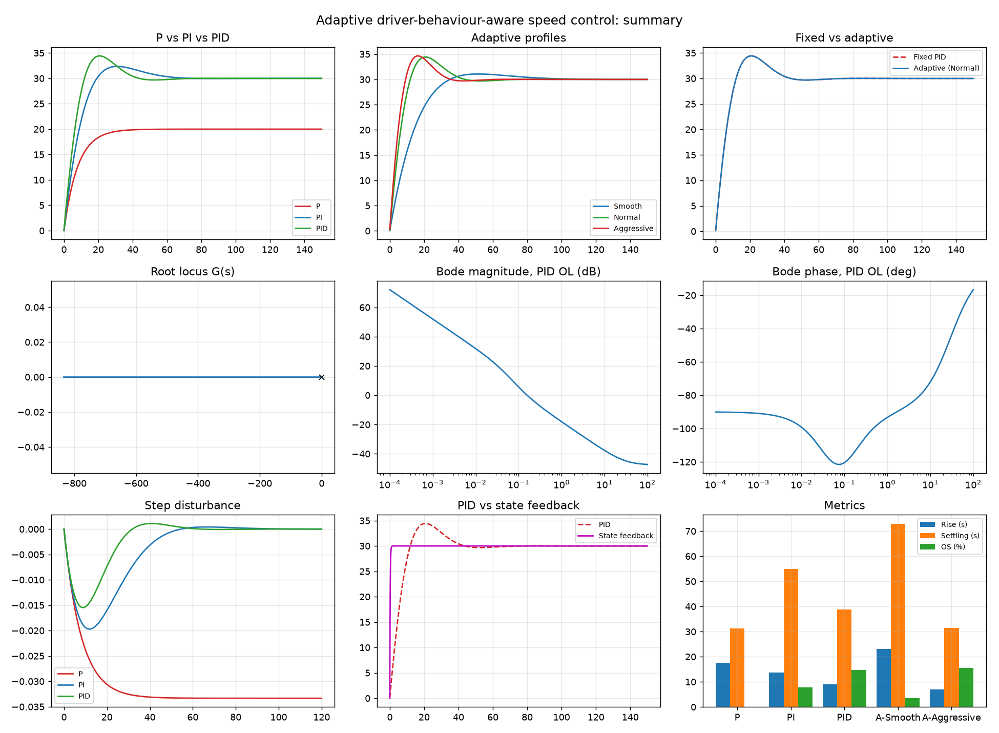

# Adaptive Driver-Behaviour-Aware Speed Control System

BECE302L Control Systems project, Winter 2025-26. Team: Siddhi Pandey, Arrnav Trisal, Sriya Ganga.

A vehicle cruise controller designed and analysed in MATLAB/Simulink. Fixed P, PI and PID controllers are compared with a gain-scheduled (adaptive) PID that switches gains by driver profile: Smooth, Normal or Aggressive. The study covers state-space pole placement, Bode, Nyquist, root locus and disturbance rejection.

The submitted report is in [`report/`](report/) (DOCX and PDF). Its original MATLAB and Simulink figures are in [`original/figures/`](original/figures/).
This repo also contains a Python re-run of the whole analysis that reproduces the report's numbers ([`results/comparison.md`](results/comparison.md)).

## Model

Plant: `m dv/dt = u(t) - b v(t)` with m = 1200 kg, b = 50 N·s/m, so

```
G(s) = 1 / (1200 s + 50)      DC gain 0.02, time constant 24 s, pole at -0.0417
```

| Controller | C(s) | Gains |
|---|---|---|
| P | Kp | Kp = 100 |
| PI | (Kp s + Ki)/s | 120, 10 |
| PID | (Kd s² + Kp s + Ki)/s | 150, 20, 5 |
| Adaptive: Smooth | PID | 80, 5, 2 |
| Adaptive: Normal | PID | 150, 20, 5 |
| Adaptive: Aggressive | PID | 200, 30, 10 |
| State feedback | u = -Kx + N̄r | K = 5950, N̄ = 6000 (pole at -5) |

Reference: 30 m/s (108 km/h) step. Unity negative feedback, `T = CG/(1+CG)`. Disturbance at the plant input, `S = G/(1+CG)`.

## Results (re-run)

| Controller | Rise (s) | Settling 2 % (s) | Overshoot (%) | Final (m/s) | PM (deg) |
|---|---|---|---|---|---|
| Fixed P | 17.58 | 31.30 | 0.00 | **20.00** | 120.00 |
| Fixed PI | 13.67 | 55.03 | 7.87 | 30.00 | 74.06 |
| Fixed PID | 8.99 | 38.87 | 14.76 | 30.00 | 64.77 |
| Adaptive Smooth | 23.09 | 72.86 | 3.58 | 30.00 | 79.35 |
| Adaptive Normal | 8.99 | 38.87 | 14.76 | 30.00 | 64.77 |
| Adaptive Aggressive | **6.97** | **31.55** | 15.51 | 30.00 | 65.45 |
| State feedback | 0.44 | 0.78 | 0.00 | 30.00 | - |

All values agree with the report to ±0.01. Gain margin is infinite for every loop.

- The P loop keeps a 33 % steady-state error (`b/(Kp+b)`). Integral action removes it.
- The Aggressive profile rises 22 % faster and settles 19 % sooner than the fixed PID. The Smooth profile gives the least overshoot.
- Pole placement at -5 gives a first-order response with no overshoot.
- Disturbance: the report's code uses an *impulse* of 5 at the plant input. Since that input is a force, the speed dip is only about 4 mm/s, and every stable loop recovers. A *sustained* disturbance shows the ranking described in the report: P keeps an offset of 0.033 m/s, PI and PID return to zero, and PID dips least. Figure 9 shows both cases. See [`results/comparison.md`](results/comparison.md).



## Run it

### MATLAB (Control System Toolbox, Simulink)

```matlab
cd matlab
speed_control            % prints metrics and margins, draws Figures 1-10, saves PNGs to results/matlab/
build_simulink_model     % builds adaptive_speed_control.slx
sim('adaptive_speed_control')
```

The Simulink model has three parallel PID loops (Smooth, Normal, Aggressive) on one scope. It also has a fourth loop whose gains come from a Multiport Switch driven by a `Profile` constant (1/2/3). MATLAB isn't installed on the machine this repo was rebuilt on, so these two scripts have not been run here. They mirror the code in the report.

### Python re-run (no MATLAB needed)

```bash
cd ~/Downloads/speedControlProj
python3 -m venv --without-pip .venv
python3 -m pip --python .venv/bin/python install -r requirements.txt

.venv/bin/python python/speed_control.py      # results/*.csv, results/comparison.md, results/figures/*.png
.venv/bin/python -m pytest -q tests           # 13 checks against the report's values
```

## Layout

```
matlab/     speed_control.m (full analysis, Figures 1-10), build_simulink_model.m
python/     speed_control.py (python-control re-run)
tests/      test_report_values.py
results/    metrics.csv, margins.csv, disturbance.csv, comparison.md, figures/
original/   figures/ - the report's MATLAB plots, Simulink block diagram and scope
report/     submitted report (DOCX + PDF)
```
