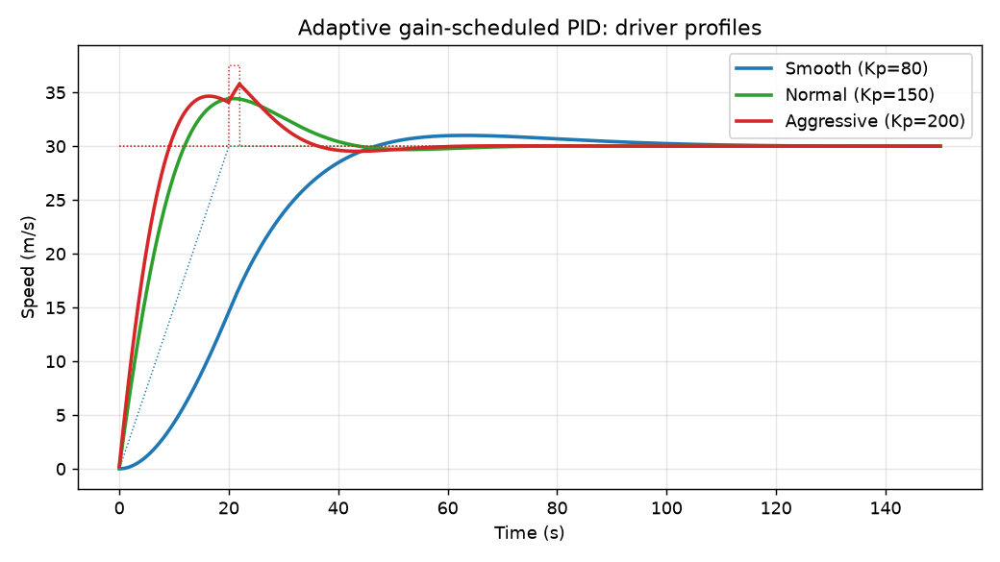

# Adaptive Driver-Behaviour-Aware Speed Control System

**A cruise controller that changes its PID gains to match the driver's style: smooth, normal or aggressive.**
Designed in MATLAB/Simulink, and fully re-run in Python, where all 13 report values are reproduced to ±0.01.


<p align="center">
  <br>
  <em>Same car, same 30 m/s target, three driver profiles. Aggressive rises 22 % faster than the fixed PID; Smooth trades speed for the least overshoot.</em>
</p>

## The idea

A fixed cruise controller is tuned once, for an average driver. People don't drive alike: some want gentle acceleration, others want the car to respond at once. This project compares the classic fixed **P, PI and PID** controllers with a **gain-scheduled (adaptive) PID** that switches gains by driver profile, plus a **state-feedback** design by pole placement. Each design is analysed in the time domain and the frequency domain, including Bode, Nyquist, root locus and disturbance rejection.

## Results

| Controller | Rise (s) | Settling 2 % (s) | Overshoot (%) | Final (m/s) | Phase margin (°) |
|---|---|---|---|---|---|
| Fixed P | 17.58 | 31.30 | 0.00 | **20.00** | 120.00 |
| Fixed PI | 13.67 | 55.03 | 7.87 | 30.00 | 74.06 |
| Fixed PID | 8.99 | 38.87 | 14.76 | 30.00 | 64.77 |
| Adaptive: Smooth | 23.09 | 72.86 | 3.58 | 30.00 | 79.35 |
| Adaptive: Normal | 8.99 | 38.87 | 14.76 | 30.00 | 64.77 |
| Adaptive: Aggressive | **6.97** | **31.55** | 15.51 | 30.00 | 65.45 |
| State feedback (pole at −5) | 0.44 | 0.78 | 0.00 | 30.00 | – |

- **P alone never reaches the target:** it settles at 20 m/s, a 33 % steady-state error (`b/(Kp+b)`). Integral action removes it.
- **Adaptive pays off:** the Aggressive profile rises 22 % faster and settles 19 % sooner than the fixed PID, while Smooth gives the gentlest ride.
- **All loops are robustly stable:** infinite gain margin and 65–120° phase margin.
- **The report's disturbance test, corrected:** an *impulse* of 5 N·s at the plant input moves the speed by only about 4 mm/s. A *sustained* disturbance shows the expected ranking: P keeps an offset, PI and PID return to zero, and PID dips least.

All numbers come from the Python re-run and match the report. See [`results/comparison.md`](results/comparison.md).


## The model

Longitudinal vehicle dynamics, `m dv/dt = u(t) − b v(t)`, with m = 1200 kg and b = 50 N·s/m:

```
G(s) = 1 / (1200 s + 50)      DC gain 0.02, time constant 24 s, pole at −0.0417
```

| Controller | Gains (Kp, Ki, Kd) |
|---|---|
| P / PI / PID | 100 / (120, 10) / (150, 20, 5) |
| Adaptive: Smooth / Normal / Aggressive | (80, 5, 2) / (150, 20, 5) / (200, 30, 10) |
| State feedback | K = 5950, N̄ = 6000 (closed-loop pole at −5) |

Reference: 30 m/s (108 km/h) step, unity negative feedback.

## Repository layout

```
matlab/     speed_control.m (full analysis, Figures 1-10), build_simulink_model.m
python/     speed_control.py (python-control re-run)
tests/      test_report_values.py (13 checks against the report)
results/    metrics.csv, margins.csv, disturbance.csv, comparison.md, figures/
original/   the report's MATLAB plots, Simulink block diagram and scope
docs/       HOW_TO_RUN.md
report/     submitted report (DOCX + PDF)
```

## Running it

Python re-run, tests, and the MATLAB/Simulink scripts: see **[docs/HOW_TO_RUN.md](docs/HOW_TO_RUN.md)**.

## Report

The submitted report is in [`report/`](report/) (DOCX and PDF). Its original MATLAB and Simulink figures are in [`original/figures/`](original/figures/).

## Team

BECE302L Control Systems, VIT Vellore, Winter Semester 2025–26: Siddhi Pandey, Arrnav Trisal, Sriya Ganga.

## License

Released under the [MIT License](LICENSE).
